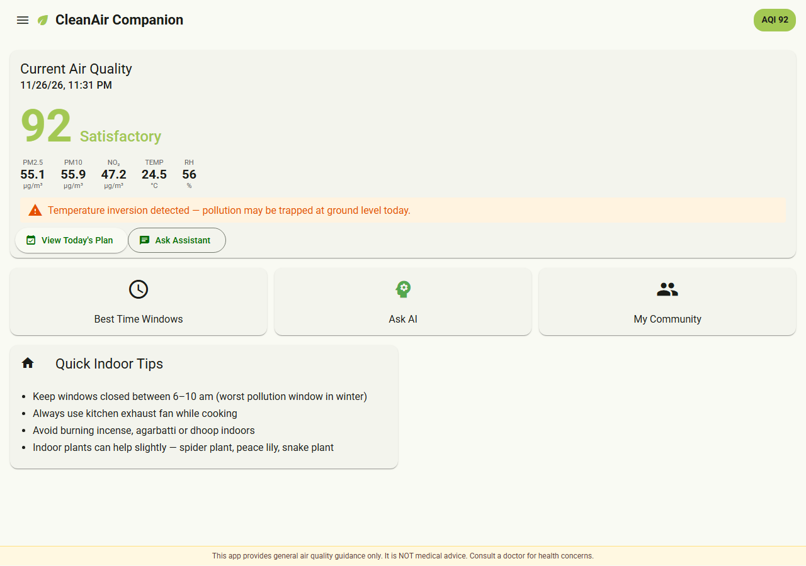
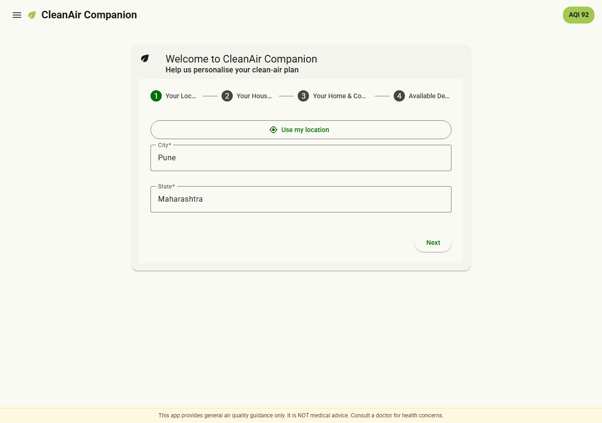
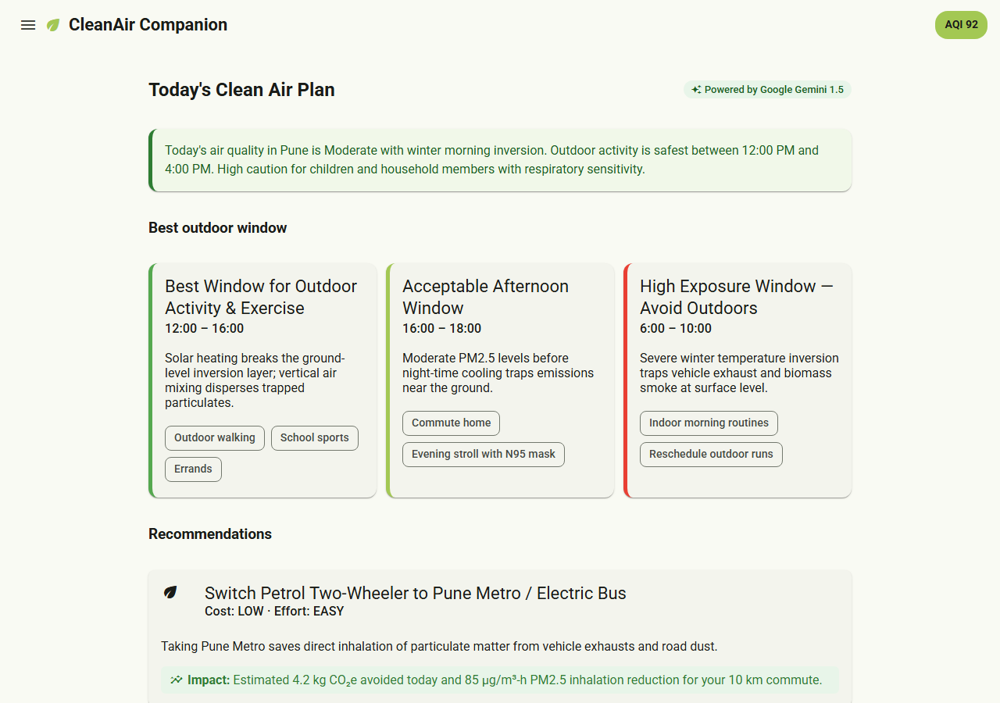
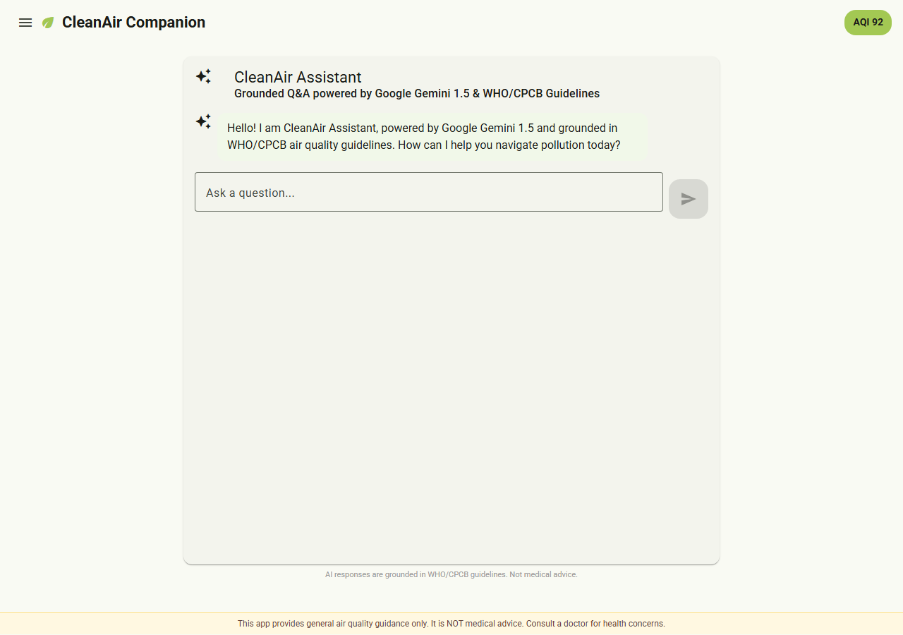
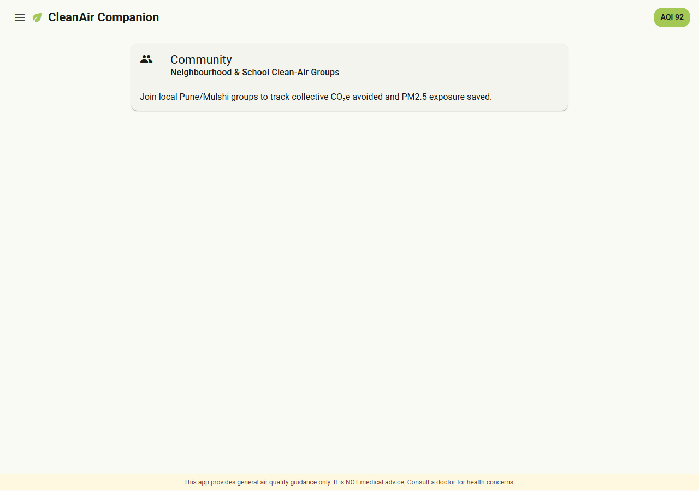
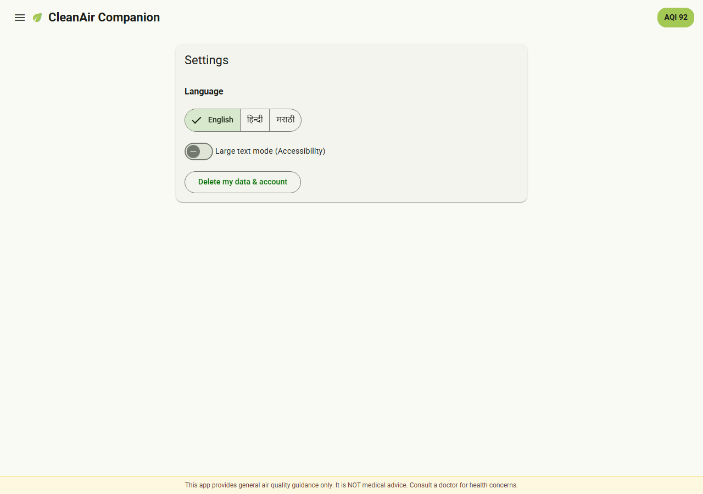
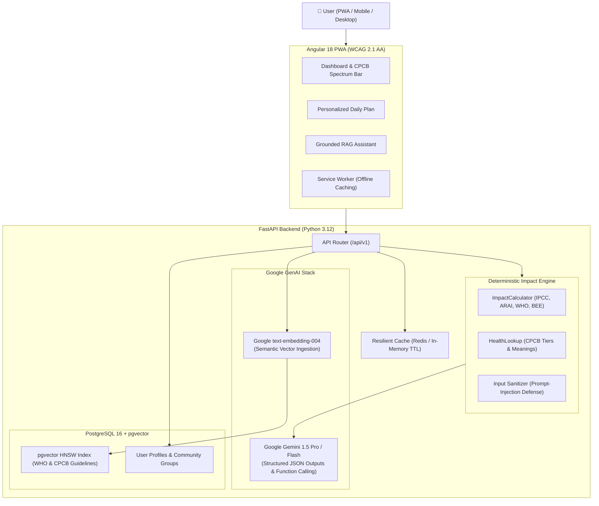

# CleanAir Companion 🍃

[](https://github.com/JC-JAY/cleanair-companion/actions/workflows/ci.yml)
[](https://ai.google.dev/)
[](https://ai.google.dev/)
[](https://angular.dev/)
[](https://fastapi.tiangolo.com/)
[](https://www.w3.org/WAI/WCAG21/quickref/)
[](LICENSE)

> **GenAI-powered, grounded assistant helping urban families navigate severe winter smog and air pollution.**  
> *Primary focus: Maharashtra, India (Pune, Mulshi, Mumbai) · Extensible to any global metropolis.*

🌐 **Live Deployed Application:** [cleanair-companion.vercel.app/dashboard](https://cleanair-companion.vercel.app/dashboard)  
⭐ **GitHub Repository:** [github.com/JC-JAY/cleanair-companion](https://github.com/JC-JAY/cleanair-companion)

---

## 🎯 Problem Statement & Alignment

### The Winter Smog & Temperature Inversion Crisis
Every winter, urban centers across India face hazardous air quality levels (AQI often surpassing 300–400+). The underlying physical phenomenon is **meteorological temperature inversion**: cold, dense air is trapped close to the ground beneath a layer of warm air, acting as an atmospheric lid that prevents vehicular exhaust, road dust, and cooking smoke from dispersing. Particulate levels peak sharply in the early morning (6:00 AM – 10:00 AM) exactly when children commute to school and adults jog outdoors.

### Critical Gaps in Existing Solutions
1. **Passive Alarmism:** Conventional air quality applications show raw numbers (e.g. *"AQI 280 - Unhealthy"*) that cause panic but provide no actionable, routine-based guidance on *when* it is safe to venture outside.
2. **AI Hallucinations in Health Tech:** Generative AI models frequently invent unverified exposure statistics, hallucinating arbitrary health claims without scientific basis.
3. **Inaccessibility:** Solutions rarely cater to multi-generational households, vernacular languages (Hindi, Marathi), low-bandwidth mobile networks (2G/3G), or users with accessibility impairments.

### The Solution: CleanAir Companion
CleanAir Companion bridges meteorological science, deterministic physics, and Google GenAI to empower families with hyper-actionable, clinically grounded daily protection:
- **Optimal Outdoor Time Windows:** Automatically detects winter temperature inversion curves to identify safest periods (e.g., 12:00 PM – 4:00 PM) for errands, school runs, and exercise.
- **Deterministic Impact Calculation (Zero Hallucination):** Every health recommendation calculates exact PM2.5 inhalation saved ($\mu\text{g/m}^3\cdot\text{h}$) and avoided $\text{CO}_2\text{e}$ emissions using cited **IPCC**, **ARAI**, **WHO**, and **BEE** peer-reviewed emission factors. The LLM explains these verified numbers; it never invents them.
- **Grounded Medical RAG:** Powered by **Google Gemini 1.5** and **Google text-embedding-004** with pgvector cosine similarity; refuses ungrounded questions below confidence threshold (0.72) and automatically escalates acute respiratory symptoms.
- **Inclusive Accessibility:** Built to **WCAG 2.1 AA** standards with keyboard skip links, high contrast, large-text toggle, offline-first PWA caching, and native English, Hindi (हिन्दी), and Marathi (मराठी) support.

---

## 📸 Visual Overview

| 1. Live AQI & Inversion Dashboard | 2. 4-Step Onboarding Wizard |
|:---:|:---:|
|  |  |
| **3. AI Daily Action Plan** | **4. Grounded Gemini RAG Chat** |
|  |  |
| **5. Community Collective Impact** | **6. Multilingual & A11y Settings** |
|  |  |

---

## 🏗 System Architecture



---

## ✨ Core Features & Modules

| Module | Purpose & Implementation |
|---|---|
| **Live AQI & Inversion Alert** | Integrates OpenAQ v3, CPCB, and Open-Meteo meteorological telemetry. Highlights surface temperature inversions and plots current AQI against the 6-tier national CPCB spectrum. |
| **Personalized Daily Plan** | Uses **Google Gemini 1.5** with strict JSON schemas to construct custom schedules: optimal outdoor windows (12 PM–4 PM), indoor sealing times (6 AM–10 AM), low-emission commute routes, and DIY hacks. |
| **Deterministic Impact Engine** | Computes biological PM2.5 exposure reduction ($\mu\text{g/m}^3\cdot\text{h}$) and tailpipe emissions avoided ($\text{kg CO}_2\text{e}$) across commute shifts, cooking fuels (biomass to LPG/induction), and air purifiers. |
| **Grounded Gemini Assistant** | Conversational health guidance grounded in WHO AQG 2021 and CPCB guidelines via **Google text-embedding-004** dense vectors. Refuses ungrounded queries ($<0.72$ cosine similarity) and includes immediate emergency medical escalations. |
| **Community Impact Hub** | Collective neighborhood challenges for Pune and Maharashtra districts, aggregating emissions avoided and particulate exposure saved across schools and societies. |
| **Inclusive & Offline-First** | Complete **WCAG 2.1 AA** compliance with `.skip-link` bypass, ARIA landmarks, offline plan storage via PWA Service Worker, and tri-lingual localization (English, Hindi, Marathi). |

---

## 🔬 Peer-Reviewed Scientific Factors

All calculations are completely reproducible, cited, and unit-tested:

| Scientific Source | Metric / Purpose | Formula / Value |
|---|---|---|
| **IPCC AR6 WG3 (Table A.III.2)** | Transport greenhouse gas factors | Private petrol car: $0.192\text{ kg CO}_2\text{e/km}$; Metro: $0.038\text{ kg CO}_2\text{e/km}$ |
| **ARAI India Vehicle Emission Factors (2019)** | City-cycle tailpipe particulates | Two-wheeler: $0.05\text{ g PM}_{2.5}\text{/km}$; Car: $0.03\text{ g/km}$; Bus: $0.20\text{ g/km}$ |
| **Chafe et al. 2015 (Lancet Respiratory Medicine)** | Household biomass vs clean cooking | Biomass chulha: $1200\text{ g PM}_{2.5}\text{/meal}$; LPG: $15\text{ g}$; Induction: $0\text{ g}$ |
| **BEE India Standards & Labelling (2021)** | Grid emission & power consumption | Residential air purifier: $45\text{ W}$; Grid intensity: $0.82\text{ kg CO}_2\text{/kWh}$ |
| **WHO Air Quality Guidelines (2021)** | Inhalation dosage & health risk | Average adult inhalation volume: $0.83\text{ m}^3\text{/h}$; Child: $0.52\text{ m}^3\text{/h}$ |
| **CPCB National AQI Standard (2014/2021)** | Spectrum classification | Good (0–50), Satisfactory (51–100), Moderate (101–200), Poor (201–300), Very Poor (301–400), Severe (401–500) |

---

## 🛡️ Security, Privacy & Guardrails

- **Cryptographic Credentials:** Zero hardcoded secrets; dynamic `secrets.token_urlsafe(32)` generation for development with mandatory production override.
- **Automated Dependency Auditing:** Active `.github/dependabot.yml` monitoring vulnerabilities in pip and npm dependencies.
- **Formal Security Policy:** Published `SECURITY.md` defining responsible disclosure, patching timelines, and threat model.
- **Prompt Injection Defense:** Multi-layer sanitization in `sanitizer.py` stripping command override attempts, instruction reset patterns, and null bytes before LLM inference.
- **Location Privacy:** Geolocation latitude and longitude coordinates are mathematically rounded to 2 decimal places ($\approx 1.1\text{ km}$ precision) to protect user residential privacy.
- **Automated CI/CD:** GitHub Actions `.github/workflows/ci.yml` runs automated linting (Ruff), type checking (Mypy), Python 3.12 pytest test matrix, and Angular production compilation on every push.

---

## 🧪 Testing Suite

The project includes unit and integration tests across both backend and frontend layers:

```bash
# Run all backend unit tests (46 passing tests in <1s)
cd backend
python -m pytest tests/unit/ -v

# Run full test suite with coverage
python -m pytest tests/unit/ -v --cov=app --cov-report=term-missing
```

### Test Coverage Highlights:
- `test_impact_calculator.py`: 30 tests validating commute, cooking fuel, purifier CADR, and IPCC emission mathematics.
- `test_health_lookup.py`: 8 tests verifying CPCB tiers, color codes, and pediatric health advice.
- `test_profile_schema.py`: 4 tests confirming Pydantic boundary checks for latitude, longitude, and enum validations.
- `test_gemini_provider.py`: Tests Google Gemini 1.5 provider initialization, model configurations, and graceful offline fallbacks.
- `test_sanitizer.py`: Tests prompt injection mitigation, multilingual unicode passthrough, and string truncation.
- `aqi.service.spec.ts`: Angular Jasmine/Karma test confirming open-meteo telemetry and caching behavior.

---

## 🚀 Quick Start Guide

### Prerequisites
- Python $\ge 3.12$
- Node.js $\ge 20$
- Google Gemini API Key ([Get one free on Google AI Studio](https://aistudio.google.com/))

### 1. Clone the Repository
```bash
git clone https://github.com/JC-JAY/cleanair-companion.git
cd cleanair-companion
```

### 2. Backend Setup
```bash
cd backend
python -m venv .venv
# Windows:
.\.venv\Scripts\activate
# Linux/macOS:
source .venv/bin/activate

pip install -r requirements.txt
python scripts/init_local_db.py
uvicorn app.main:app --reload --port 8000
```

### 3. Frontend Setup
```bash
cd ../frontend
npm install
npm start
```
Open [http://localhost:4200](http://localhost:4200) to view the application.

---

## 📄 License
This project is licensed under the MIT License — see the [LICENSE](LICENSE) file for details. Built with ❤️ for the Google Developer Hackathon.
